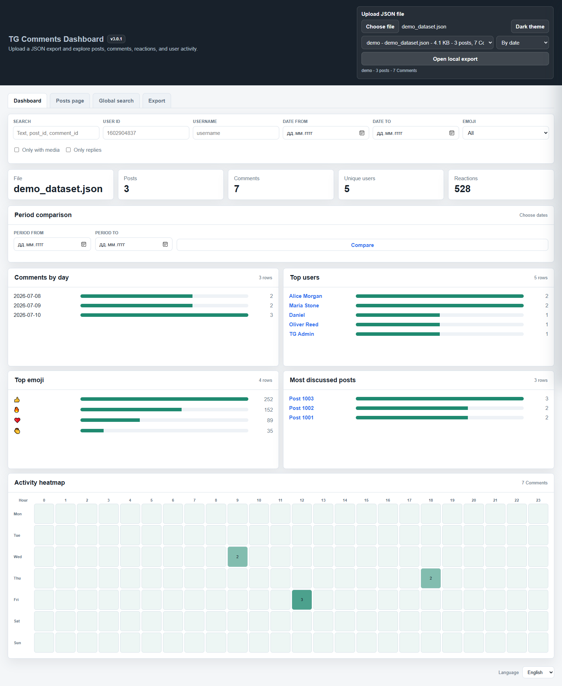
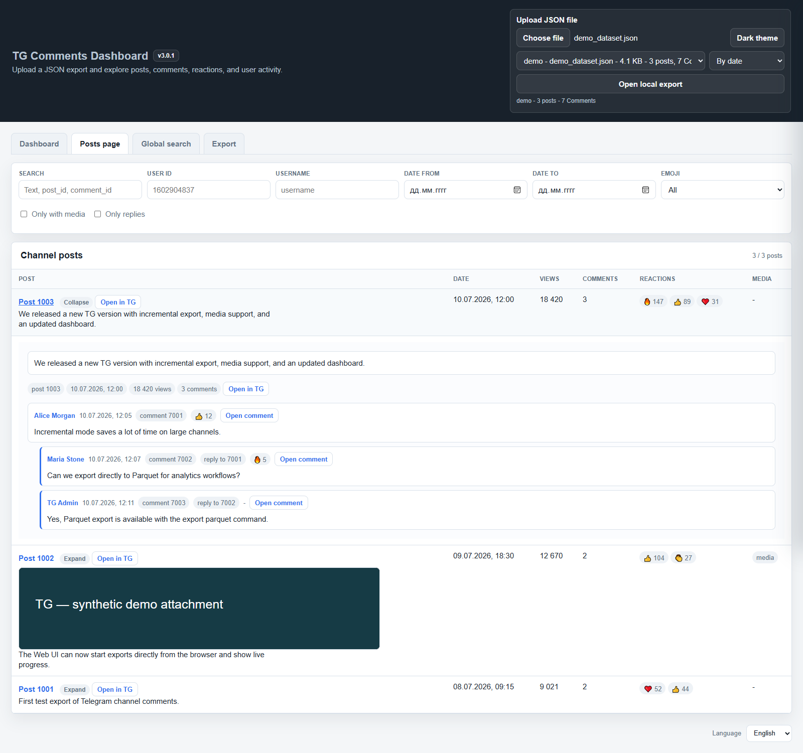
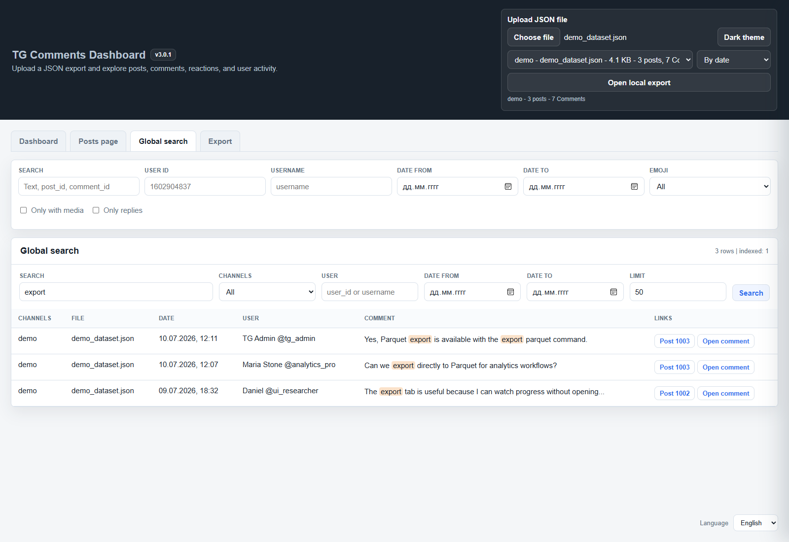
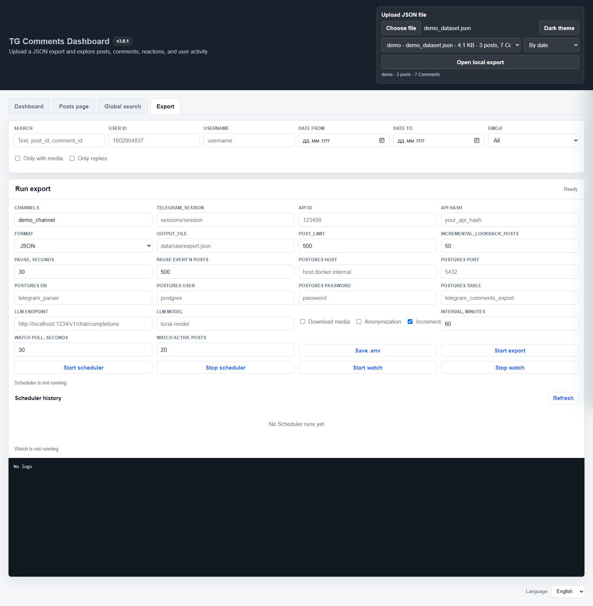

# TG

[Русский](README_ru.md) | [中文](README_cn.md)

TG is a local-first Telegram comments exporter and analytics dashboard with incremental updates, Watch mode, a scheduler, LLM analysis and an MCP server.

Current version: `3.0.1`.

## Features

- Export posts, discussion comments, reactions, links and optional media from one or more channels.
- Export to JSON, CSV, Parquet or PostgreSQL; retain compatibility with JSON arrays of posts.
- Refresh older posts during incremental export, reusing downloaded media.
- Batch Watch events and update only changed posts in SQLite.
- Explore charts, activity heatmaps, period comparisons, comment trees, user profiles and global search.
- Run one-off exports, a scheduler or Watch from the dashboard.
- Assign stable readable pseudonyms and restore user identity fields using a private map.
- Analyze JSON exports with configurable ru/en/zh prompts; automate local operations over MCP.

## Quick start

Install Docker Desktop and start the dashboard:

```powershell
docker compose up --build dashboard
```

Open **http://localhost:9595**. Compose creates `.env` from `.env.example` if it is missing. Fill in Telegram settings in the Export tab. For the first Telegram login, run an interactive CLI export and follow the prompts; subsequent runs reuse `sessions/`.

To explore without credentials, upload [examples/example.json](examples/example.json) with **Choose file**. For global search and server-backed views, copy that synthetic file into `data/raw/` and open it as a local export. Uploading alone does not persist or index a file.

## Screenshots

Real UI captures from version 3.0.1, using only the synthetic example (3 posts, 7 comments). [Reproduce the screenshots](docs/screenshots.md).



| Post and comment tree | Global comment search |
| --- | --- |
|  |  |



## Configuration

Copy `.env.example` to `.env` to configure it manually. The complete safe template is [.env.example](.env.example).

```env
API_ID=123456
API_HASH=your_api_hash_here
CHANNEL=your_channel,another_channel
TELEGRAM_SESSION=sessions/session
OUTPUT_FILE=data/raw/export.json
POST_LIMIT=500
INCREMENTAL_LOOKBACK_POSTS=50
POSTS_PAUSE_SECONDS=30
POSTS_PAUSE_AFTER_POSTS=500

# Required only for LLM analysis
LLM_ENDPOINT=http://host.docker.internal:1234/v1/chat/completions
LLM_MODEL=local-model

# Required only for PostgreSQL export
POSTGRES_HOST=host.docker.internal
POSTGRES_PORT=5432
POSTGRES_DB=telegram_parser
POSTGRES_USER=postgres
POSTGRES_PASSWORD=your_postgres_password_here
POSTGRES_TABLE=telegram_comments_export
```

`export` and `watch` require `API_ID`, `API_HASH` and `CHANNEL`. Only `analyze` requires `LLM_ENDPOINT`/`LLM_MODEL`; PostgreSQL settings are required only for that export target. `CHANNEL` accepts comma-separated names or links. `OUTPUT_FILE` determines the output directory. `POST_LIMIT` limits new/latest posts; `INCREMENTAL_LOOKBACK_POSTS` revisits known older posts. Pause settings control Telegram request pacing. In Docker, `localhost` is the container; use `host.docker.internal` for an LLM/PostgreSQL service on the Docker Desktop host. The project directory is mounted at `/workspace`; configuration uses `/workspace/.env`, while runtime data and sessions are mounted under `/app`.

## CLI commands

```powershell
docker compose run --rm cli --help
docker compose run --rm cli config-check
docker compose run --rm cli export json --incremental
docker compose run --rm cli export json --incremental --download-media --anonymize
docker compose run --rm cli export csv
docker compose run --rm cli export parquet
docker compose run --rm cli export postgresql
docker compose run --rm cli watch --poll-interval 30 --refresh-active-posts 20 --anonymize
docker compose run --rm cli index --file examples/example.json
docker compose run --rm cli search "incremental" --file examples/example.json
docker compose run --rm cli compare --from 2026-07-01 --to 2026-08-01 --file examples/example.json
docker compose run --rm cli analyze examples/example.json --limit 3 --language en
docker compose run --rm -i cli mcp
```

Run locally with `python main.py <command>` after installing `requirements.txt`. The `tg` name shown in help is the parser name, not an installed executable. Docker is preferred when the Windows Python alias is broken. `config-check` validates Telegram, LLM and PostgreSQL settings together; unused optional services can therefore fail that full check.

## Incremental export, Watch and Scheduler

Incremental datasets are `data/raw/<channel>_dataset.json`, with per-channel JSON state and a derived SQLite index at `data/state/tg.sqlite`. New posts and the configured old-post lookback are merged by `post_id`; comments are merged by `comment_id`.

Watch collects events for one second, deduplicates queued posts and processes up to 20 posts per channel per batch. JSON is read once per batch and atomically rewritten once if changed; SQLite patches only the changed posts, comments, reactions and FTS entries. A missing/stale index triggers a full rebuild. Already fetched changes are saved on FloodWait or task cancellation. The JSON file is still rewritten in full at each changed batch.

Scheduler starts immediately and repeats every `interval_minutes`. If an export is running, a due run is skipped. Scheduler state is in memory: restarting the dashboard stops scheduling. Run history is persisted in SQLite; old `data/scheduler/` JSON records are imported lazily. Watch is a separate long-running process. Avoid concurrent writers to the same dataset/session.

## Reversible pseudonyms

The default `--anonymize` rules are [anonymization_rules.json](anonymization_rules.json): adjective + animal, for example «Зелёный слон». Names remain stable across Export/Watch restarts, with numeric suffixes on collisions. Scope defaults to a channel; `project` scope is available for a new map. `--anonymizer-file` accepts JSON rules or a legacy text name list.

```powershell
docker compose run --rm cli anonymize --file examples/example.json --channel demo --output data/raw/demo_anonymous.json
docker compose run --rm cli deanonymize --file data/raw/demo_anonymous.json --channel demo --map data/private/anonymization_map.json --output data/raw/demo_restored.json
```

Both conversion commands create a new file and refuse to overwrite existing files. `--channel` must match the original channel. The map `data/private/anonymization_map.json` contains original user identities in **unencrypted JSON**; protect it and keep a separate backup. It is excluded from Git, Docker images and HTTP/MCP reads. Text, links and media remain unchanged. Legacy in-memory pseudonyms cannot generally be restored. Incompatible identity modes are rejected during incremental updates. See [pseudonym rules, restoration and migration](docs/anonymization.md).

## LLM analysis and MCP

Prompt files live in `prompts/llm_ru.json`, `llm_en.json` and `llm_zh.json`. `--prompt-file` overrides `--language`; the JSON object requires `system` and `user_template`, containing `{data}`. Analysis files are written incrementally to `data/analysis/analysis_<source>.json`; SQLite also stores analysis metadata and cache entries.

**Known limitation:** the current `build_post_prompt_payload()` does not return its prepared payload. Verify/fix that before relying on LLM results or content-based cache invalidation. See [implementation notes](docs/architecture.md#known-limitations).

MCP runs over stdio with interactive stdin (`-i`). Tools include `get_config_safe`, `list_exports`, `get_export_summary`, `search_comments`, `search_all_comments`, `get_post`, `list_analysis_files`, `list_analysis_results`, `read_analysis`, `run_analysis`, `start_export`, and `get_export_process_status`. Live export requires `confirm=true`. There is no MCP tool for identity restoration.

## Errors and recovery

Expected HTTP application failures include `error_code` alongside `ok`/`error`; process conflicts return 409, corrupt data 422, unavailable index 503 and process start failures 500. CLI expected failures return 2 without a traceback; unexpected failures log a traceback and return 1. Invalid export JSON stops processing; the exporter loader saves a backup instead of substituting an empty dataset. Repair/restore the archive before retrying. SQLite failure can use JSON fallback for summary/comparison; programming errors do not silently trigger fallback. [Full error reference](docs/errors.md).

## Local data and access

Do not commit `.env`, sessions, private identity maps, exports, media, analysis, SQLite state or scheduler history. Keep runtime `.gitkeep` files. The dashboard currently has no authentication and Compose publishes port 9595 on all host interfaces; use it only on a trusted local network or bind `127.0.0.1:9595:9595`. `/api/config` can read/write sensitive settings. Static `/data/` access is restricted to `raw`, `content` and `analysis`; `private`, `state` and `scheduler` are not served.

## Project structure and developer checks

```text
main.py                        CLI entrypoint
api/                           HTTP routes and error boundary
services/                      Configuration, export queries, processes, scheduler
exporters/                     Telegram export and Watch batching
storage/                       JSON files, SQLite index, history and LLM cache
telegram/                      Message helpers and reversible pseudonyms
analytics/                     Summaries and period comparison
llm/                           LLM analysis
web/                           HTML, CSS and JavaScript dashboard
mcp_server.py                  MCP tools over stdio
errors.py                      Expected application errors
version.py                     Application version
anonymization_rules.json       Public pseudonym naming rules
anonymizer                     Legacy text list of names
prompts/                       ru / en / zh prompts
examples/example.json          Synthetic demonstration dataset
tests/                         Offline regression tests
docs/                          Architecture, API, errors, pseudonyms, screenshots
data/raw/                      JSON and other exported files
data/content/                  Downloaded media
data/analysis/                 LLM output
data/state/                    SQLite index and per-channel state
data/scheduler/                Legacy JSON scheduler history
data/private/                  Private identity map (never publish)
sessions/                      Telegram sessions (never publish)
```

[Architecture](docs/architecture.md) · [HTTP API](docs/api.md) · [Pseudonyms](docs/anonymization.md) · [Errors](docs/errors.md) · [Screenshot workflow](docs/screenshots.md) · [Agent guidance](AGENTS.md)

Use `/workspace` for checks against the current checkout without rebuilding: `/app` contains the image snapshot. These checks do not contact Telegram. Rebuild the dashboard image after changing dependencies or image contents.

```powershell
docker compose config --quiet
docker compose run --rm --workdir /workspace --entrypoint python cli docs/check_docs.py
docker compose run --rm --workdir /workspace --entrypoint python cli -m unittest discover -s tests -v
docker compose run --rm --workdir /workspace --entrypoint python cli -m compileall -q errors.py main.py mcp_server.py api services exporters storage telegram analytics llm tests
docker compose build dashboard
```
