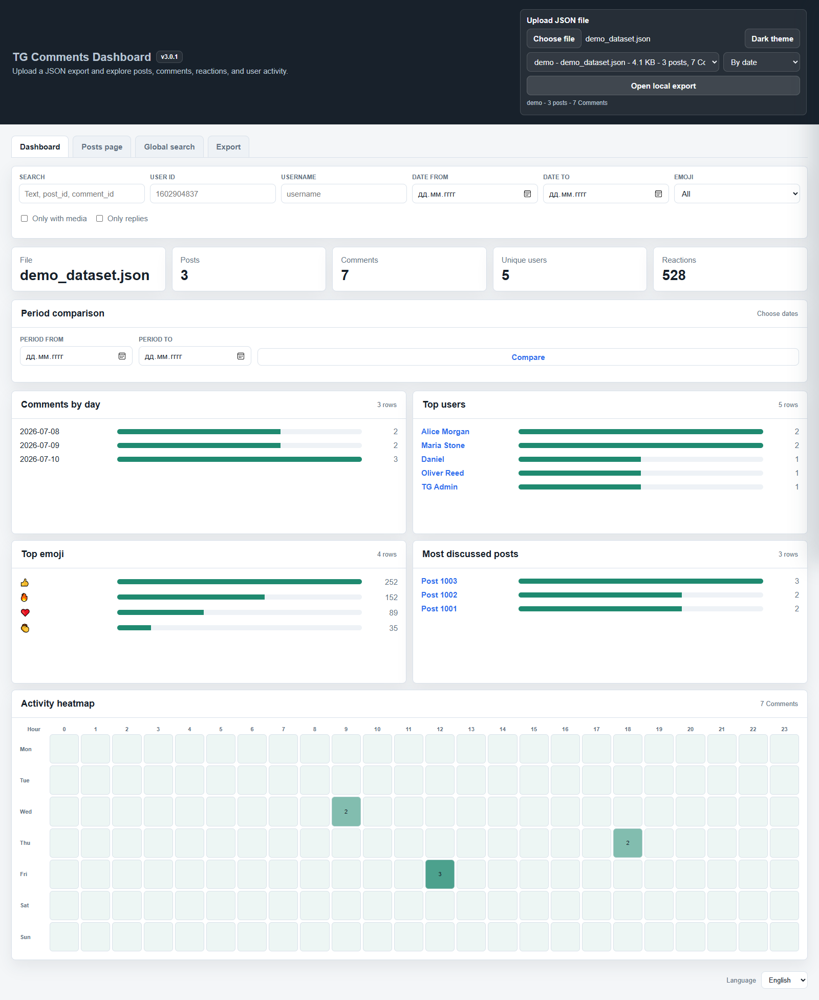
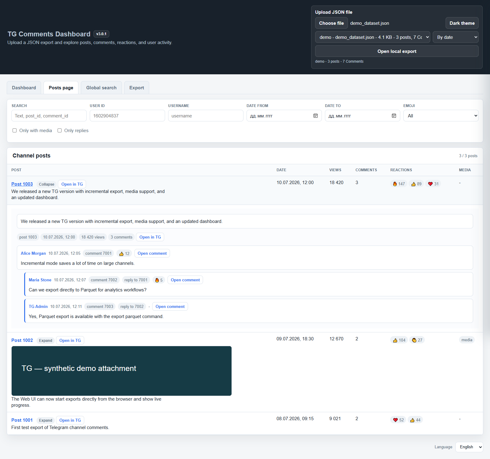
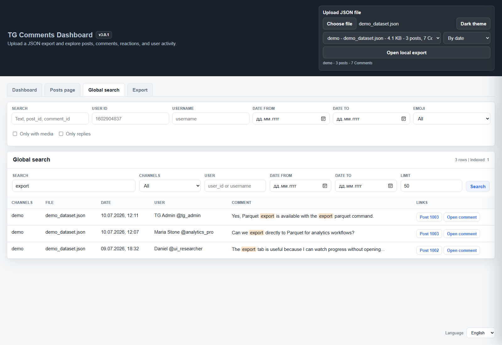
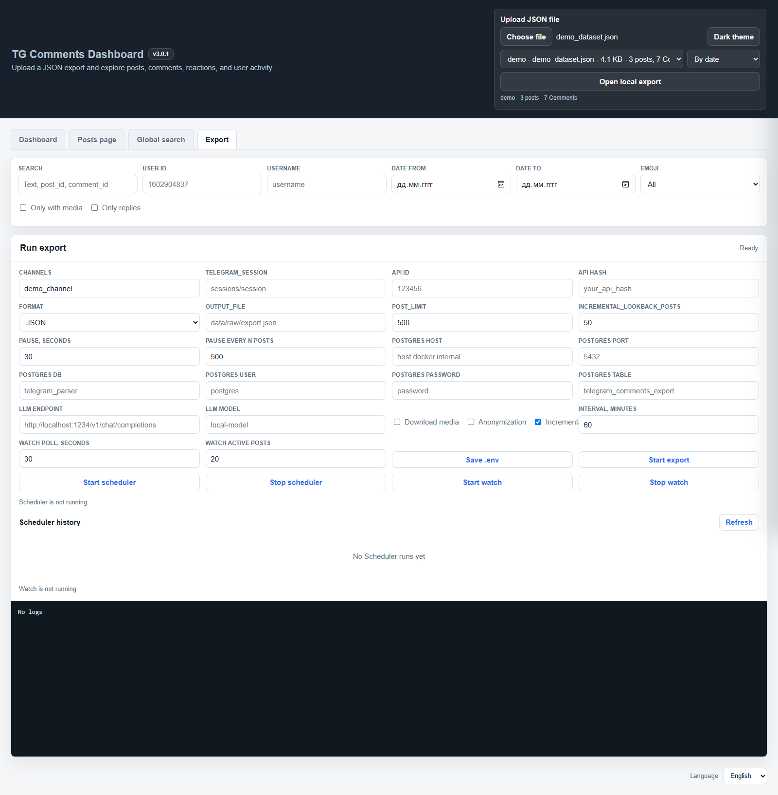

# TG

[English](README.md) | [Русский](README_ru.md)

TG 是本地优先的 Telegram 评论导出与分析工具，支持增量更新、Watch、定时任务、LLM 分析和 MCP 服务器。

当前版本: `3.0.1`.

## 功能

- 从一个或多个频道导出帖子、讨论区评论、反应、链接和可选媒体。
- 支持 JSON、CSV、Parquet、PostgreSQL，保留普通帖子数组 JSON 的兼容性。
- 增量导出会回看旧帖子，并复用已下载的媒体。
- Watch 合并事件，仅更新 SQLite 中变化的帖子。
- 图表、活动热力图、周期对比、评论树、用户详情和全局搜索。
- 在浏览器启动单次导出、Scheduler 或 Watch。
- 稳定可读的用户别名，可通过私有映射恢复身份字段。
- ru/en/zh 提示词驱动的 LLM 分析，以及 MCP 本地自动化。

## 快速启动

安装 Docker Desktop 并启动 dashboard：

```powershell
docker compose up --build dashboard
```

打开 **http://localhost:9595**。首次启动若没有 `.env`，Compose 会从 `.env.example` 创建。请在 Export 页填写 Telegram 设置。首次 Telegram 登录应使用交互式 CLI 导出并按提示操作；后续运行复用 `sessions/`。

无需凭据即可用文件选择按钮上传 [examples/example.json](examples/example.json)。如需全局搜索和服务器视图，请将该合成示例复制到 `data/raw/`，作为本地导出打开。单纯浏览器上传不会在服务器持久化或索引文件。

## 截图

版本 3.0.1 的真实界面截图，仅使用合成示例：3 个帖子、7 条评论。[重新生成截图](docs/screenshots.md)。



| 帖子与评论树 | 全局评论搜索 |
| --- | --- |
|  |  |



## 配置

手动配置时将 `.env.example` 复制为 `.env`。完整安全模板：[.env.example](.env.example)。

```env
API_ID=123456
API_HASH=your_api_hash_here
CHANNEL=your_channel,another_channel
TELEGRAM_SESSION=sessions/session
OUTPUT_FILE=data/raw/export.json
POST_LIMIT=500
INCREMENTAL_LOOKBACK_POSTS=50
POSTS_PAUSE_SECONDS=30
POSTS_PAUSE_AFTER_POSTS=500

# Required only for LLM analysis
LLM_ENDPOINT=http://host.docker.internal:1234/v1/chat/completions
LLM_MODEL=local-model

# Required only for PostgreSQL export
POSTGRES_HOST=host.docker.internal
POSTGRES_PORT=5432
POSTGRES_DB=telegram_parser
POSTGRES_USER=postgres
POSTGRES_PASSWORD=your_postgres_password_here
POSTGRES_TABLE=telegram_comments_export
```

`export` 和 `watch` 需要 `API_ID`、`API_HASH`、`CHANNEL`。只有 `analyze` 需要 `LLM_ENDPOINT`/`LLM_MODEL`；PostgreSQL 设置仅用于该导出目标。`CHANNEL` 接受逗号分隔的名称或链接。`OUTPUT_FILE` 决定输出目录；`POST_LIMIT` 限制新/最近帖子，`INCREMENTAL_LOOKBACK_POSTS` 指定回看旧帖数。暂停设置控制 Telegram 请求节奏。在 Docker 内 `localhost` 指容器；Docker Desktop 主机上的 LLM/PostgreSQL 应使用 `host.docker.internal`。项目挂载在 `/workspace`，配置来自 `/workspace/.env`，运行数据和会话挂载在 `/app` 下。

## CLI 命令

```powershell
docker compose run --rm cli --help
docker compose run --rm cli config-check
docker compose run --rm cli export json --incremental
docker compose run --rm cli export json --incremental --download-media --anonymize
docker compose run --rm cli export csv
docker compose run --rm cli export parquet
docker compose run --rm cli export postgresql
docker compose run --rm cli watch --poll-interval 30 --refresh-active-posts 20 --anonymize
docker compose run --rm cli index --file examples/example.json
docker compose run --rm cli search "incremental" --file examples/example.json
docker compose run --rm cli compare --from 2026-07-01 --to 2026-08-01 --file examples/example.json
docker compose run --rm cli analyze examples/example.json --limit 3 --language en
docker compose run --rm -i cli mcp
```

安装 `requirements.txt` 后可在本地使用 `python main.py <command>`。帮助中的 `tg` 是解析器名称，并非已安装的可执行命令。Windows Python 别名失效时请用 Docker。`config-check` 同时检查 Telegram、LLM 和 PostgreSQL，因此未使用的可选服务也可能导致完整检查失败。

## 增量导出、Watch 和 Scheduler

增量存档为 `data/raw/<channel>_dataset.json`，频道状态保存在 JSON 和派生 SQLite 索引 `data/state/tg.sqlite`。新帖子和配置范围内的旧帖子按 `post_id` 合并，评论按 `comment_id` 合并。

Watch 收集一秒内的事件，对待处理帖子去重，每批每频道最多处理 20 个帖子。每批读取一次 JSON，仅有变化时原子重写一次；SQLite 仅更新变化的帖子、评论、反应和 FTS 记录。索引缺失或过期时完整重建。FloodWait 或任务取消时会保存已获取的变化。每次保存仍会重写完整 JSON 文件。

Scheduler 首次立即运行，之后每隔 `interval_minutes` 重复。已有导出运行时跳过本次任务。调度状态保存在内存，重启 dashboard 会停止调度；历史存入 SQLite，旧 `data/scheduler/` JSON 记录按需导入。Watch 是独立长期进程。避免同时写同一存档或并发使用同一会话。

## 可逆用户别名

默认 `--anonymize` 规则位于 [anonymization_rules.json](anonymization_rules.json)，由形容词与动物名组成，例如 «Зелёный слон»。Export/Watch 重启后别名保持稳定；组合耗尽时追加编号。默认按频道隔离，新映射可选择 `project` 范围。`--anonymizer-file` 接受 JSON 规则或旧文本名字列表。

```powershell
docker compose run --rm cli anonymize --file examples/example.json --channel demo --output data/raw/demo_anonymous.json
docker compose run --rm cli deanonymize --file data/raw/demo_anonymous.json --channel demo --map data/private/anonymization_map.json --output data/raw/demo_restored.json
```

两条转换命令都创建新文件并拒绝覆盖。`--channel` 必须与原频道一致。`data/private/anonymization_map.json` 以**未加密 JSON** 保存原身份，请保护并单独备份。映射不进入 Git、Docker 镜像，也不能通过 HTTP/MCP 读取。文本、链接和媒体保持不变。旧内存别名通常无法恢复。不兼容的身份模式会阻止增量更新。[规则、恢复与迁移](docs/anonymization.md)。

## LLM 分析与 MCP

提示词位于 `prompts/llm_ru.json`、`llm_en.json`、`llm_zh.json`。`--prompt-file` 优先于 `--language`；JSON 需含 `system` 和带 `{data}` 的 `user_template`。分析逐步写入 `data/analysis/analysis_<source>.json`，SQLite 保存分析元数据和缓存。

**已知限制：** 当前 `build_post_prompt_payload()` 没有返回已构造的数据。依赖 LLM 结果或内容缓存失效机制前，请先检查/修复该函数。[实现限制](docs/architecture.md#known-limitations)。

MCP 使用 stdio 和交互式 stdin（`-i`）。工具包括 `get_config_safe`、`list_exports`、`get_export_summary`、`search_comments`、`search_all_comments`、`get_post`、`list_analysis_files`、`list_analysis_results`、`read_analysis`、`run_analysis`、`start_export`、`get_export_process_status`。实时导出要求 `confirm=true`。没有恢复身份的 MCP 工具。

## 错误与恢复

预期 HTTP 应用错误除 `ok`/`error` 外包含 `error_code`：进程冲突 409、损坏数据 422、索引不可用 503、进程启动失败 500。CLI 预期错误返回 2 且无 traceback，意外错误记录 traceback 并返回 1。无效 JSON 会停止处理；导出加载器保存备份而不返回空存档。重试前请修复或恢复文件。SQLite 不可用时 summary/compare 保留 JSON fallback，编程错误不会静默触发 fallback。[错误参考](docs/errors.md)。

## 本地数据与访问

不要提交 `.env`、会话、私有映射、导出、媒体、分析、SQLite 状态或调度历史。保留运行目录的 `.gitkeep`。Dashboard 当前没有认证，Compose 默认在主机全部接口发布 9595 端口；请在可信本地网络使用，或绑定 `127.0.0.1:9595:9595`。`/api/config` 可读写敏感设置。`/data/` 仅提供 `raw`、`content`、`analysis`，不提供 `private`、`state`、`scheduler`。

## 项目结构与开发检查

```text
main.py                        CLI entrypoint
api/                           HTTP routes and error boundary
services/                      Configuration, export queries, processes, scheduler
exporters/                     Telegram export and Watch batching
storage/                       JSON files, SQLite index, history and LLM cache
telegram/                      Message helpers and reversible pseudonyms
analytics/                     Summaries and period comparison
llm/                           LLM analysis
web/                           HTML, CSS and JavaScript dashboard
mcp_server.py                  MCP tools over stdio
errors.py                      Expected application errors
version.py                     Application version
anonymization_rules.json       Public pseudonym naming rules
anonymizer                     Legacy text list of names
prompts/                       ru / en / zh prompts
examples/example.json          Synthetic demonstration dataset
tests/                         Offline regression tests
docs/                          Architecture, API, errors, pseudonyms, screenshots
data/raw/                      JSON and other exported files
data/content/                  Downloaded media
data/analysis/                 LLM output
data/state/                    SQLite index and per-channel state
data/scheduler/                Legacy JSON scheduler history
data/private/                  Private identity map (never publish)
sessions/                      Telegram sessions (never publish)
```

[架构](docs/architecture.md) · [HTTP API](docs/api.md) · [用户别名](docs/anonymization.md) · [错误](docs/errors.md) · [截图流程](docs/screenshots.md) · [代理说明](AGENTS.md)

不重建镜像而检查当前工作区时使用 `/workspace`；`/app` 是构建时的代码快照。以下检查不访问 Telegram。依赖或镜像内容变化后请重建 dashboard。

```powershell
docker compose config --quiet
docker compose run --rm --workdir /workspace --entrypoint python cli docs/check_docs.py
docker compose run --rm --workdir /workspace --entrypoint python cli -m unittest discover -s tests -v
docker compose run --rm --workdir /workspace --entrypoint python cli -m compileall -q errors.py main.py mcp_server.py api services exporters storage telegram analytics llm tests
docker compose build dashboard
```
