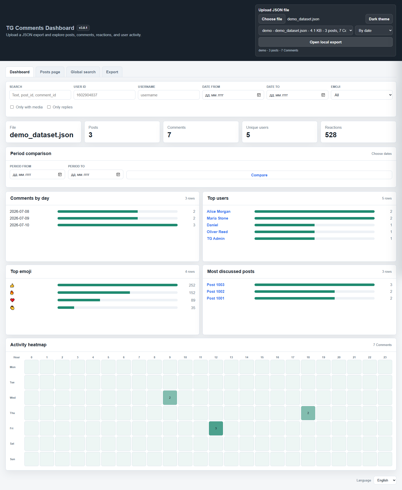
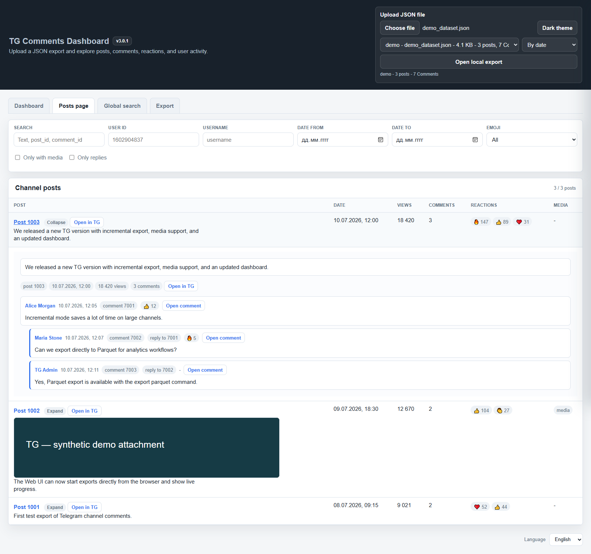
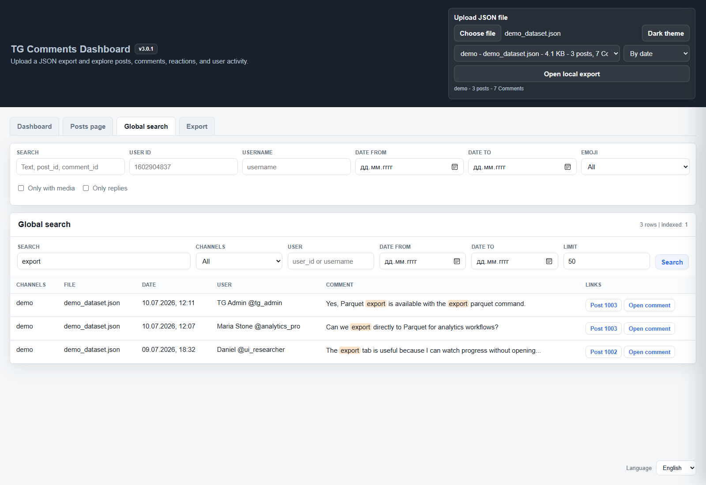
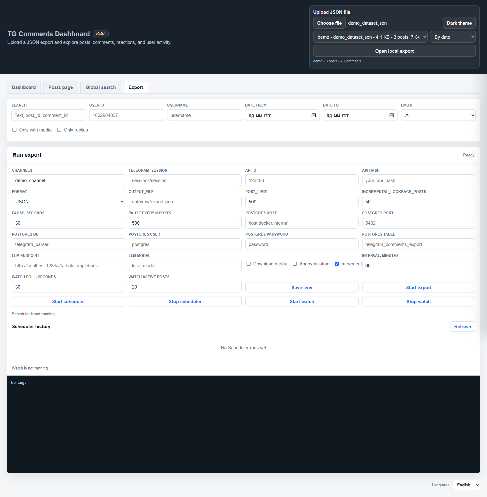

# TG

[English](README.md) | [中文](README_cn.md)

TG — локальный экспортер комментариев Telegram и аналитический dashboard с инкрементальными обновлениями, Watch, планировщиком, LLM-анализом и MCP-сервером.

Текущая версия: `3.0.1`.

## Возможности

- Экспорт постов, комментариев обсуждений, реакций, ссылок и медиа из одного или нескольких каналов.
- Форматы JSON, CSV, Parquet и PostgreSQL; совместимость с JSON-массивами постов.
- Повторная проверка старых постов при инкрементальном экспорте и переиспользование скачанных медиа.
- Пакетная обработка событий Watch и обновление только изменённых постов в SQLite.
- Графики, тепловая карта, сравнение периодов, дерево комментариев, профили пользователей и глобальный поиск.
- Разовый экспорт, Scheduler и Watch из браузера.
- Постоянные читаемые псевдонимы и восстановление полей пользователя по закрытой карте.
- Анализ JSON через LLM с промптами ru/en/zh и локальная автоматизация через MCP.

## Быстрый старт

Установите Docker Desktop и запустите dashboard:

```powershell
docker compose up --build dashboard
```

Откройте **http://localhost:9595**. Если `.env` отсутствует, Compose создаст его из `.env.example`. Заполните настройки Telegram во вкладке «Экспорт». Первую авторизацию выполните интерактивным CLI-экспортом по подсказкам Telethon; следующие запуски используют сессию из `sessions/`.

Без учётных данных загрузите [examples/example.json](examples/example.json) кнопкой выбора файла. Для глобального поиска и серверных представлений скопируйте этот демонстрационный файл в `data/raw/` и откройте как локальный экспорт. Загрузка через браузер сама по себе не сохраняет и не индексирует файл на сервере.

## Скриншоты

Реальный интерфейс версии 3.0.1 на синтетическом примере: 3 поста и 7 комментариев. [Как переснять скриншоты](docs/screenshots.md).



| Пост и дерево комментариев | Глобальный поиск комментариев |
| --- | --- |
|  |  |



## Конфигурация

Для ручной настройки скопируйте `.env.example` в `.env`. Полный безопасный шаблон: [.env.example](.env.example).

```env
API_ID=123456
API_HASH=your_api_hash_here
CHANNEL=your_channel,another_channel
TELEGRAM_SESSION=sessions/session
OUTPUT_FILE=data/raw/export.json
POST_LIMIT=500
INCREMENTAL_LOOKBACK_POSTS=50
POSTS_PAUSE_SECONDS=30
POSTS_PAUSE_AFTER_POSTS=500

# Required only for LLM analysis
LLM_ENDPOINT=http://host.docker.internal:1234/v1/chat/completions
LLM_MODEL=local-model

# Required only for PostgreSQL export
POSTGRES_HOST=host.docker.internal
POSTGRES_PORT=5432
POSTGRES_DB=telegram_parser
POSTGRES_USER=postgres
POSTGRES_PASSWORD=your_postgres_password_here
POSTGRES_TABLE=telegram_comments_export
```

`export` и `watch` требуют `API_ID`, `API_HASH`, `CHANNEL`. Только `analyze` требует `LLM_ENDPOINT`/`LLM_MODEL`; PostgreSQL-настройки нужны только для соответствующего формата экспорта. В `CHANNEL` можно перечислить имена или ссылки через запятую. `OUTPUT_FILE` определяет каталог экспорта. `POST_LIMIT` ограничивает новые/последние посты, а `INCREMENTAL_LOOKBACK_POSTS` задаёт повторную проверку старых. Настройки пауз регулируют частоту запросов Telegram. В Docker `localhost` означает контейнер: для LLM/PostgreSQL на хосте Docker Desktop используйте `host.docker.internal`. Проект смонтирован в `/workspace`, конфигурация читается из `/workspace/.env`, данные и сессии смонтированы под `/app`.

## Команды CLI

```powershell
docker compose run --rm cli --help
docker compose run --rm cli config-check
docker compose run --rm cli export json --incremental
docker compose run --rm cli export json --incremental --download-media --anonymize
docker compose run --rm cli export csv
docker compose run --rm cli export parquet
docker compose run --rm cli export postgresql
docker compose run --rm cli watch --poll-interval 30 --refresh-active-posts 20 --anonymize
docker compose run --rm cli index --file examples/example.json
docker compose run --rm cli search "incremental" --file examples/example.json
docker compose run --rm cli compare --from 2026-07-01 --to 2026-08-01 --file examples/example.json
docker compose run --rm cli analyze examples/example.json --limit 3 --language en
docker compose run --rm -i cli mcp
```

Для локального запуска установите `requirements.txt` и используйте `python main.py <команда>`. `tg` в справке — имя парсера, а не установленный исполняемый файл. Если Windows Python alias не работает, используйте Docker. `config-check` проверяет Telegram, LLM и PostgreSQL вместе: проверка может завершиться ошибкой для неиспользуемого необязательного сервиса.

## Инкрементальный экспорт, Watch и Scheduler

Инкрементальный архив — `data/raw/<channel>_dataset.json`; состояние канала хранится в JSON и производном SQLite-индексе `data/state/tg.sqlite`. Новые посты и заданное количество старых объединяются по `post_id`, комментарии — по `comment_id`.

Watch собирает события одну секунду, объединяет повторы ожидающих постов и обрабатывает до 20 постов канала за пакет. JSON читается один раз на пакет и атомарно перезаписывается один раз при изменениях. SQLite обновляет только изменённые посты, комментарии, реакции и FTS-записи; отсутствующий или устаревший индекс перестраивается полностью. Полученные изменения сохраняются при FloodWait или отмене задачи. Сам JSON при сохранении по-прежнему перезаписывается целиком.

Scheduler запускает первый экспорт сразу, затем повторяет через `interval_minutes`. Если экспорт ещё работает, очередной запуск пропускается. Расписание хранится в памяти: перезапуск dashboard останавливает Scheduler. История сохраняется в SQLite, старые JSON-записи из `data/scheduler/` импортируются лениво. Watch — отдельный долгоживущий процесс. Избегайте одновременной записи в один архив и использования одной сессии несколькими писателями.

## Обратимые псевдонимы

Правила `--anonymize` по умолчанию находятся в [anonymization_rules.json](anonymization_rules.json): прилагательное и животное, например «Зелёный слон». Имена сохраняются после перезапуска Export/Watch; при исчерпании сочетаний добавляется номер. По умолчанию соответствия отдельные для каждого канала; область `project` доступна для новой карты. `--anonymizer-file` принимает JSON-правила или старый текстовый список имён.

```powershell
docker compose run --rm cli anonymize --file examples/example.json --channel demo --output data/raw/demo_anonymous.json
docker compose run --rm cli deanonymize --file data/raw/demo_anonymous.json --channel demo --map data/private/anonymization_map.json --output data/raw/demo_restored.json
```

Обе команды создают новый файл и отказываются перезаписывать существующий. `--channel` должен совпадать с исходным каналом. `data/private/anonymization_map.json` содержит исходные данные пользователей в **незашифрованном JSON**: защищайте карту и делайте отдельную резервную копию. Она исключена из Git, Docker-образа и HTTP/MCP. Тексты, ссылки и медиа остаются без изменений. Старые псевдонимы из памяти обычно восстановить нельзя. Инкрементальное обновление отклоняет несовместимые режимы идентификации. [Правила, восстановление и миграция](docs/anonymization.md).

## LLM-анализ и MCP

Промпты: `prompts/llm_ru.json`, `llm_en.json`, `llm_zh.json`. `--prompt-file` важнее `--language`; JSON должен содержать `system` и `user_template` с `{data}`. Анализ записывается постепенно в `data/analysis/analysis_<source>.json`; SQLite также хранит метаданные анализа и кеш.

**Известное ограничение:** текущая `build_post_prompt_payload()` не возвращает подготовленные данные. Перед использованием результатов LLM и кеша по содержимому нужно проверить/исправить эту функцию. [Технические ограничения](docs/architecture.md#known-limitations).

MCP работает через stdio с интерактивным stdin (`-i`). Инструменты: `get_config_safe`, `list_exports`, `get_export_summary`, `search_comments`, `search_all_comments`, `get_post`, `list_analysis_files`, `list_analysis_results`, `read_analysis`, `run_analysis`, `start_export`, `get_export_process_status`. Живой экспорт требует `confirm=true`. Восстановление личности через MCP не предоставляется.

## Ошибки и восстановление

Ожидаемые HTTP-ошибки приложения содержат `error_code` вместе с `ok`/`error`: конфликт процесса — 409, повреждённые данные — 422, недоступный индекс — 503, ошибка старта — 500. CLI возвращает 2 для ожидаемой ошибки без traceback, 1 — для неожиданной с traceback. Повреждённый JSON останавливает обработку; загрузчик экспортера сохраняет копию вместо пустого архива. До повторного запуска восстановите или исправьте файл. При недоступном SQLite для summary/compare сохраняется JSON fallback; ошибки программирования его не запускают. [Справочник ошибок](docs/errors.md).

## Локальные данные и доступ

Не коммитьте `.env`, сессии, закрытые карты, экспорты, медиа, анализ, SQLite и историю планировщика. Сохраняйте `.gitkeep` в runtime-каталогах. Dashboard пока не имеет авторизации, а Compose публикует порт 9595 на всех интерфейсах хоста: используйте доверенную локальную сеть или привязку `127.0.0.1:9595:9595`. `/api/config` читает и изменяет чувствительные настройки. Через `/data/` доступны только `raw`, `content`, `analysis`; `private`, `state`, `scheduler` не раздаются.

## Структура и проверки для разработчиков

```text
main.py                        CLI entrypoint
api/                           HTTP routes and error boundary
services/                      Configuration, export queries, processes, scheduler
exporters/                     Telegram export and Watch batching
storage/                       JSON files, SQLite index, history and LLM cache
telegram/                      Message helpers and reversible pseudonyms
analytics/                     Summaries and period comparison
llm/                           LLM analysis
web/                           HTML, CSS and JavaScript dashboard
mcp_server.py                  MCP tools over stdio
errors.py                      Expected application errors
version.py                     Application version
anonymization_rules.json       Public pseudonym naming rules
anonymizer                     Legacy text list of names
prompts/                       ru / en / zh prompts
examples/example.json          Synthetic demonstration dataset
tests/                         Offline regression tests
docs/                          Architecture, API, errors, pseudonyms, screenshots
data/raw/                      JSON and other exported files
data/content/                  Downloaded media
data/analysis/                 LLM output
data/state/                    SQLite index and per-channel state
data/scheduler/                Legacy JSON scheduler history
data/private/                  Private identity map (never publish)
sessions/                      Telegram sessions (never publish)
```

[Архитектура](docs/architecture.md) · [HTTP API](docs/api.md) · [Псевдонимы](docs/anonymization.md) · [Ошибки](docs/errors.md) · [Скриншоты](docs/screenshots.md) · [Инструкции агентам](AGENTS.md)

Для проверки текущего рабочего дерева без пересборки используйте `/workspace`: в `/app` находится код из образа. Эти проверки не обращаются к Telegram. После изменения зависимостей или содержимого образа пересоберите dashboard.

```powershell
docker compose config --quiet
docker compose run --rm --workdir /workspace --entrypoint python cli docs/check_docs.py
docker compose run --rm --workdir /workspace --entrypoint python cli -m unittest discover -s tests -v
docker compose run --rm --workdir /workspace --entrypoint python cli -m compileall -q errors.py main.py mcp_server.py api services exporters storage telegram analytics llm tests
docker compose build dashboard
```
